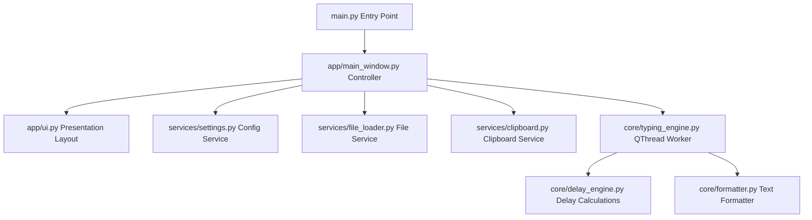

# Architecture Guide - AutoTyper

This document outlines the software architecture of the **AutoTyper** desktop application.

---

## 🏛️ Architecture Overview

AutoTyper follows a clean, modular architecture conforming to **SOLID** principles, separating user interface layouts from business execution logic and services.

---

## 📦 Component Descriptions

### 1. Presentation Layer (`app/`)
* **`ui.py`**: A pure layout class that constructs PySide6 widgets, grids, layouts, and style associations. No logic or configuration state is stored here.
* **`main_window.py`**: The central controller window that manages GUI states, connects slot event handlers, restores settings, and controls background thread lifecycles.

### 2. Core Execution Layer (`core/`)
* **`typing_engine.py`**: Implements `TypingWorker` as a `QThread`. Types characters using native Win32 `SendInput` APIs to ensure layout independence. Connects the global keyboard hook listener for emergency cancellations.
* **`delay_engine.py`**: Computes millisecond delays using typing speed formulas, human mode variations, and punctuation pause multipliers.
* **`formatter.py`**: normalizes line endings (`\r\n` and `\r` to `\n`) to preserve text indentation structures.

### 3. Services Layer (`services/`)
* **`settings.py`**: Handles configuration serialization and recovery to `config.json`. Implements strict type safety boundaries to prevent invalid settings inputs.
* **`file_loader.py`**: Imports Plain Text (`.txt`), Markdown (`.md`), and Word (`.docx`) files. Attempts encoding loaders (`utf-8-sig`, `utf-16`, and `latin-1`) sequentially.
* **`clipboard.py`**: Simple wrapper around the PySide6 system clipboard.

---

## 🛡️ Key Safety Patterns

### 1. Thread Cleanup & Joins
To prevent C++ QThread garbage collection warnings or application crashes on shutdown:
* The MainWindow controller explicitly joins worker threads inside `on_worker_finished` using `self.worker.wait()` before resetting references.
* The global keyboard listener hook (`pynput.keyboard.Listener`) is explicitly stopped inside the `finally` block of the typing worker loop.

### 2. Config File Recovery
To prevent corrupted user settings from crashing the application:
* The settings service catches JSON parsing errors on load, logs the exception, resets values to defaults, and saves them to disk instantly to restore a clean state.
* If user-configured sliders are polluted with invalid types, strict type validations reject the changes and log warnings.
